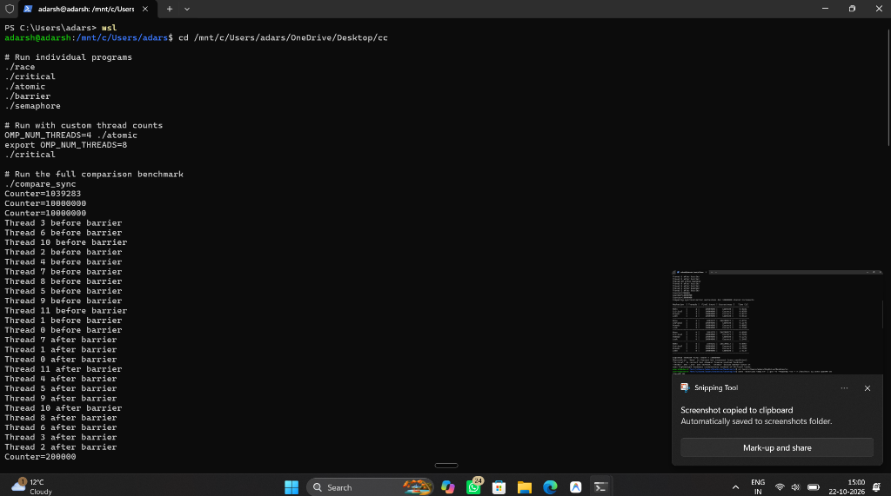
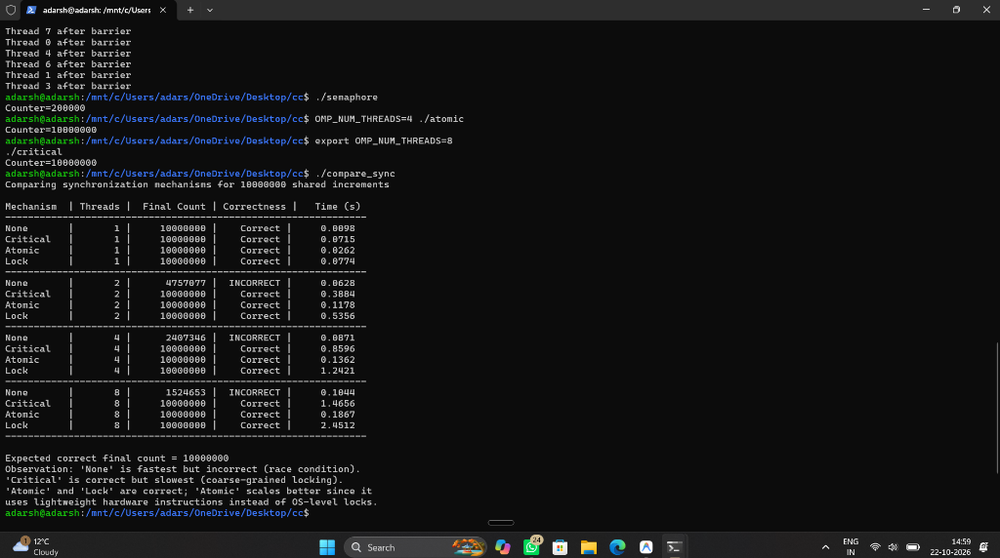

# 🔄 OpenMP Synchronization Benchmark

A comparative study of **OpenMP synchronization mechanisms** for shared-memory parallel programming. This project benchmarks four approaches — **None (Race)**, **Critical Section**, **Atomic**, and **Lock (Semaphore)** — across multiple thread counts using 10,000,000 shared counter increments.

---

## 📁 Repository Structure

```
openmp-sync-benchmark/
├── code/                    # All C source files + Makefile
│   ├── race.c               # No synchronization (race condition demo)
│   ├── critical.c           # #pragma omp critical
│   ├── atomic.c             # #pragma omp atomic
│   ├── barrier.c            # #pragma omp barrier
│   ├── semaphore.c          # omp_lock_t (mutex/semaphore simulation)
│   ├── compare_sync.c       # Full benchmark: all mechanisms vs thread counts
│   └── Makefile             # Build all targets
├── images/                  # Terminal screenshots of program output
│   ├── output_part1.png     # Running individual programs + barrier output
│   ├── output_part2.png     # Same session (duplicate screenshot)
│   └── benchmark_results.png# Full compare_sync benchmark table + observations
├── graphs/                  # (Add performance graphs here)
└── README.md
```

---

## ⚙️ Synchronization Mechanisms

| Mechanism | Description | Correctness | Performance |
|-----------|-------------|-------------|-------------|
| **None** | No synchronization — threads race | ❌ Incorrect | ⚡ Fastest |
| **Critical** | `#pragma omp critical` — coarse mutex | ✅ Correct | 🐢 Slowest |
| **Atomic** | `#pragma omp atomic` — hardware instruction | ✅ Correct | 🚀 Fast & scalable |
| **Lock** | `omp_lock_t` — OS-level mutex (semaphore) | ✅ Correct | 🔶 Moderate |
| **Barrier** | `#pragma omp barrier` — phase synchronization | N/A | Phase sync only |

---

## 📊 Benchmark Results (10,000,000 increments)

| Mechanism | Threads | Final Count | Correctness | Time (s) |
|-----------|---------|-------------|-------------|----------|
| None      | 1       | 10000000    | Correct     | 0.0098   |
| Critical  | 1       | 10000000    | Correct     | 0.0715   |
| Atomic    | 1       | 10000000    | Correct     | 0.0262   |
| Lock      | 1       | 10000000    | Correct     | 0.0774   |
| None      | 2       | 4757077     | **INCORRECT** | 0.0628 |
| Critical  | 2       | 10000000    | Correct     | 0.3884   |
| Atomic    | 2       | 10000000    | Correct     | 0.1178   |
| Lock      | 2       | 10000000    | Correct     | 0.5356   |
| None      | 4       | 2407346     | **INCORRECT** | 0.0871 |
| Critical  | 4       | 10000000    | Correct     | 0.8596   |
| Atomic    | 4       | 10000000    | Correct     | 0.1362   |
| Lock      | 4       | 10000000    | Correct     | 1.2421   |
| None      | 8       | 1524653     | **INCORRECT** | 0.1044 |
| Critical  | 8       | 10000000    | Correct     | 1.4656   |
| Atomic    | 8       | 10000000    | Correct     | 0.1867   |
| Lock      | 8       | 10000000    | Correct     | 2.4512   |

---

## 🖼️ Screenshots

### Program Execution & Barrier Output


### Full Benchmark Results Table


---

## 🔬 Key Observations

- **`None` (Race Condition)** — Fastest but produces wrong results. The counter loses increments due to simultaneous reads/writes across threads.
- **`Critical`** — Correct but the slowest; it serializes all threads into a single queue at the critical section (coarse-grained locking).
- **`Atomic`** — Correct and scales well. Uses lightweight hardware-level instructions (e.g., `LOCK XADD` on x86), avoiding kernel calls.
- **`Lock` (omp_lock_t)** — Correct but slower than `Atomic`; relies on OS-level mutex primitives, adding overhead especially at higher thread counts.
- **`Barrier`** — Not a counter-sync mechanism; used for phase synchronization — all threads must reach the barrier before any can proceed.

---

## 🚀 How to Build & Run

### Prerequisites
- GCC with OpenMP support (`gcc -fopenmp`)
- Linux / WSL (Windows Subsystem for Linux)

### Build all programs
```bash
cd code
make
```

### Run individual programs
```bash
./race
./critical
./atomic
./barrier
./semaphore
```

### Run with custom thread counts
```bash
OMP_NUM_THREADS=4 ./atomic
export OMP_NUM_THREADS=8
./critical
```

### Run the full comparison benchmark
```bash
./compare_sync
```

---

## 📌 Concepts Covered

- **Race Condition** — Unsynchronized access to shared memory
- **Critical Section** — Mutual exclusion with `#pragma omp critical`
- **Atomic Operation** — Hardware-atomic increment with `#pragma omp atomic`
- **Barrier Synchronization** — Phase-based thread coordination
- **Semaphore / Mutex** — Lock-based mutual exclusion with `omp_lock_t`
- **Scalability Analysis** — Performance vs. thread count tradeoffs

---

## 👨‍💻 Author

**Adarsh**  
Operating Systems / Parallel Computing Lab  
*Date: October 2026*

---

## 📄 License

This project is for educational purposes. Feel free to use and modify.
