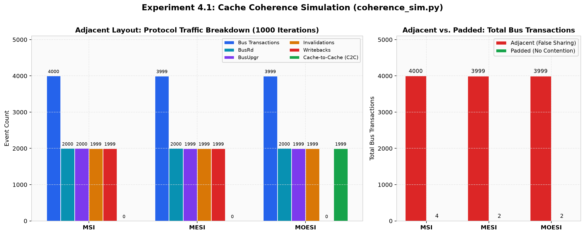
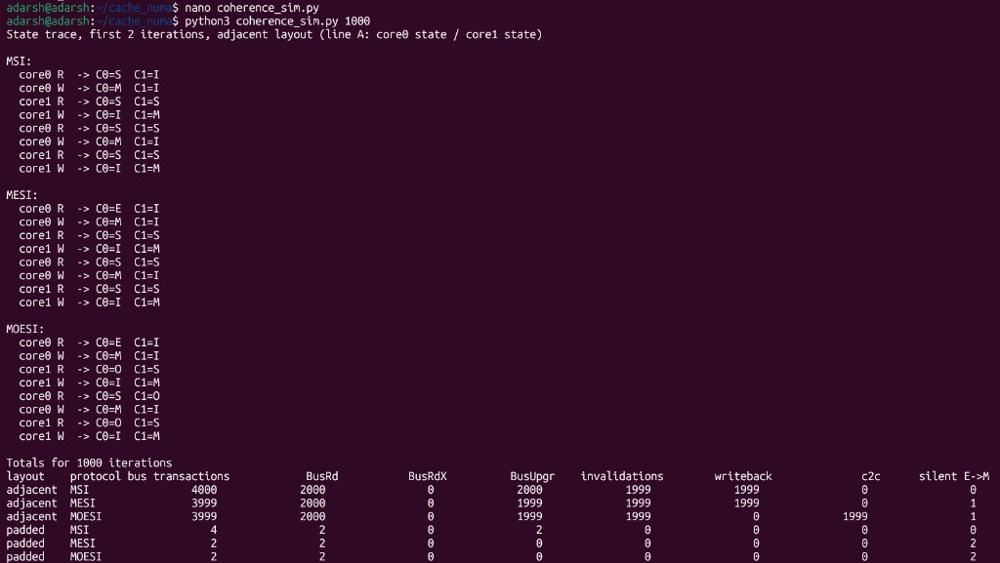
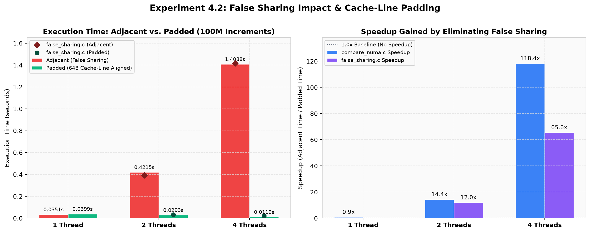
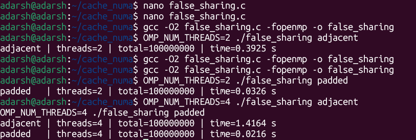
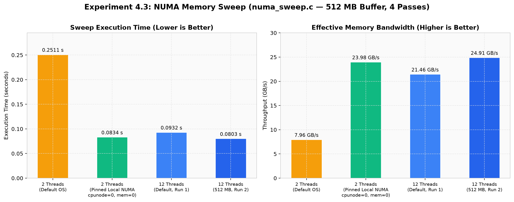
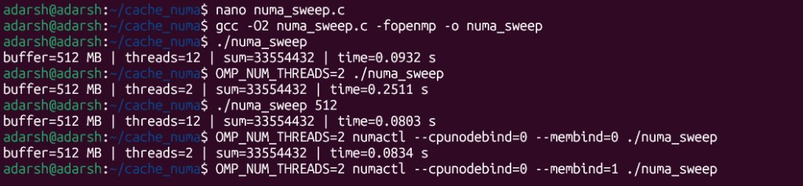
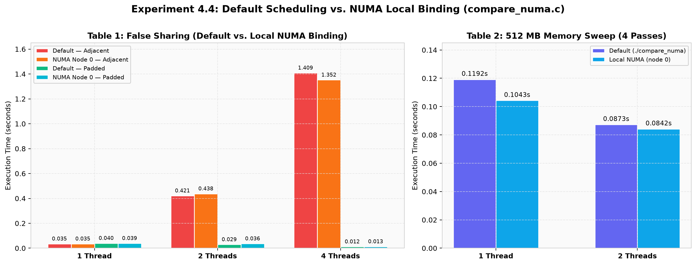
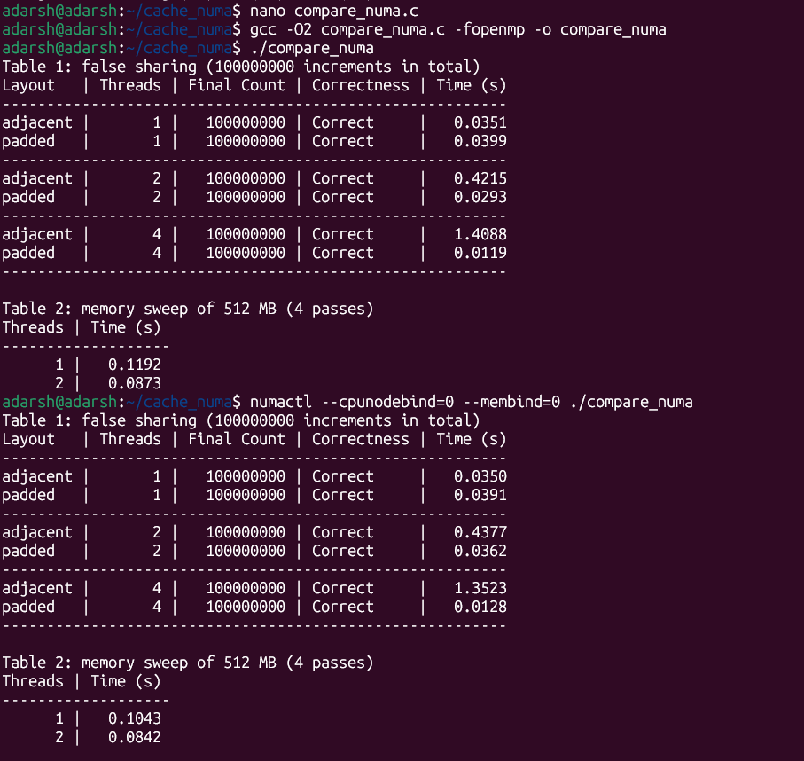

# Experiment 4 — Cache Coherence, False Sharing & NUMA Effects

## Overview

This experiment investigates three fundamental performance factors in multicore and multiprocessor computer architectures:

1. **Cache Coherence Protocols (`coherence_sim.py`)** — Simulating MSI, MESI, and MOESI state transitions and bus traffic under adjacent (false-sharing) vs. padded memory layouts.
2. **False Sharing (`false_sharing.c`)** — Measuring the severe cache-line ping-pong overhead of adjacent shared counters vs. 64-byte cache-line padded counters in OpenMP.
3. **NUMA Memory Bandwidth & Pinning (`numa_sweep.c`, `compare_numa.c`)** — Observing the impact of thread count and NUMA node pinning (`numactl`) on memory-sweep throughput and false-sharing behavior.

---

## Folder Structure

```text
exp 4/
├── README.md                            # Main experiment documentation (this file)
├── images/                              # Terminal execution screenshots
│   ├── screenshot1_coherence_sim.jpg    # MSI / MESI / MOESI simulation output
│   ├── screenshot2_false_sharing.png    # False sharing adjacent vs. padded timings
│   ├── screenshot3_numa_sweep.jpg       # 512 MB NUMA memory sweep timings
│   └── screenshot4_compare_numa.png     # Combined comparison benchmark output
├── graphs/                              # Visual charts generated from observed data
│   ├── graph1_coherence_protocols.png   # Protocol bus traffic & layout comparison
│   ├── graph2_false_sharing.png         # Execution time & speedup from padding
│   ├── graph3_numa_sweep.png            # Sweep execution time & effective bandwidth
│   └── graph4_compare_numa.png          # Default vs. local NUMA node 0 comparison
└── code/                                # Source code & graph generator
    ├── coherence_sim.py                 # Python MSI / MESI / MOESI simulator
    ├── false_sharing.c                  # C OpenMP false-sharing benchmark
    ├── numa_sweep.c                     # C OpenMP NUMA memory sweep benchmark
    ├── compare_numa.c                   # C combined false-sharing & sweep benchmark
    ├── plot_graphs.py                   # Matplotlib script to generate ../graphs/*.png
    └── README.md                        # Code-level quick reference
```

---

## 1. Cache Coherence Simulation (`coherence_sim.py`)

Simulates **MSI**, **MESI**, and **MOESI** coherence protocols for 2 cores (`core0` and `core1`) executing alternating Read/Write operations over 1,000 iterations.

### Run
```bash
python3 code/coherence_sim.py 1000
```

### Observed Results (1,000 Iterations)

| Layout | Protocol | Bus Transactions | BusRd | BusRdX | BusUpgr | Invalidations | Writebacks | C2C | Silent E→M |
| :--- | :--- | :---: | :---: | :---: | :---: | :---: | :---: | :---: | :---: |
| `adjacent` | **MSI** | 4000 | 2000 | 0 | 2000 | 1999 | 1999 | 0 | 0 |
| `adjacent` | **MESI** | 3999 | 2000 | 0 | 1999 | 1999 | 1999 | 0 | 1 |
| `adjacent` | **MOESI** | 3999 | 2000 | 0 | 1999 | 1999 | **0** | **1999** | 1 |
| `padded` | **MSI** | 4 | 2 | 0 | 2 | 0 | 0 | 0 | 0 |
| `padded` | **MESI** | 2 | 2 | 0 | 0 | 0 | 0 | 0 | 2 |
| `padded` | **MOESI** | 2 | 2 | 0 | 0 | 0 | 0 | 0 | 2 |

### Key Takeaways
- **MESI** saves the initial `BusUpgr` via a silent `E → M` transition when a core has exclusive ownership.
- **MOESI** eliminates all 1,999 memory writebacks under sharing contention by transitioning `M → O` and servicing reads via **Cache-to-Cache (C2C)** transfers.
- **Padding** reduces total bus transactions by **~99.9%** (from ~4,000 down to 2–4).

### Graph & Screenshot


<details>
<summary>View Terminal Screenshot (screenshot1_coherence_sim.jpg)</summary>



</details>

---

## 2. False Sharing Benchmark (`false_sharing.c`)

Measures 100,000,000 counter increments when threads write to **adjacent** `long` counters (sharing one 64-byte cache line) versus **padded** counters (isolated on separate 64-byte cache lines).

### Compile & Run
```bash
gcc -O2 code/false_sharing.c -fopenmp -o false_sharing
OMP_NUM_THREADS=2 ./false_sharing adjacent
OMP_NUM_THREADS=2 ./false_sharing padded
OMP_NUM_THREADS=4 ./false_sharing adjacent
OMP_NUM_THREADS=4 ./false_sharing padded
```

### Observed Results

| Layout | Threads | Final Total | Time (s) | Speedup (vs. Adjacent) |
| :--- | :---: | :---: | :---: | :---: |
| `adjacent` | 2 | 100,000,000 | 0.3925 s | 1.0× |
| `padded` | 2 | 100,000,000 | **0.0326 s** | **12.0×** |
| `adjacent` | 4 | 100,000,000 | 1.4164 s | 1.0× |
| `padded` | 4 | 100,000,000 | **0.0216 s** | **65.6×** |

### Key Takeaways
- With `adjacent` layout, adding threads **degrades** performance (0.3925 s at 2 threads → 1.4164 s at 4 threads) due to cache-line bouncing.
- With 64-byte `padded` layout, adding threads **improves** performance (0.0326 s → 0.0216 s), yielding a **65.6× speedup** at 4 threads.

### Graph & Screenshot


<details>
<summary>View Terminal Screenshot (screenshot2_false_sharing.png)</summary>



</details>

---

## 3. NUMA Memory Bandwidth Sweep (`numa_sweep.c`)

Allocates a 512 MB array (`uint64_t`), initializes it with OpenMP first-touch, and performs 4 full read passes (2.0 GB total data read).

### Compile & Run
```bash
gcc -O2 code/numa_sweep.c -fopenmp -o numa_sweep
./numa_sweep
OMP_NUM_THREADS=2 ./numa_sweep
./numa_sweep 512
OMP_NUM_THREADS=2 numactl --cpunodebind=0 --membind=0 ./numa_sweep
```

### Observed Results (512 MB, 4 Passes = 2.0 GB)

| Configuration | Threads | Time (s) | Effective Bandwidth (GB/s) |
| :--- | :---: | :---: | :---: |
| Default OS Scheduling | 2 | 0.2511 s | 7.96 GB/s |
| Pinned Local NUMA (`--cpunodebind=0 --membind=0`) | 2 | **0.0834 s** | **23.98 GB/s** |
| Default OS Scheduling (Run 1) | 12 | 0.0932 s | 21.46 GB/s |
| Explicit `512` Arg (Run 2) | 12 | **0.0803 s** | **24.91 GB/s** |

### Key Takeaways
- Pinning both threads and memory to **local NUMA node 0** at 2 threads reduces sweep time from **0.2511 s to 0.0834 s** (**3.01× faster**), matching 12-thread throughput.

### Graph & Screenshot


<details>
<summary>View Terminal Screenshot (screenshot3_numa_sweep.jpg)</summary>



</details>

---

## 4. Combined NUMA & False Sharing Comparison (`compare_numa.c`)

Runs both the false-sharing benchmark (1, 2, 4 threads) and the 512 MB memory sweep (1, 2 threads) back-to-back under default scheduling and local NUMA pinning (`numactl --cpunodebind=0 --membind=0`).

### Compile & Run
```bash
gcc -O2 code/compare_numa.c -fopenmp -o compare_numa
./compare_numa
numactl --cpunodebind=0 --membind=0 ./compare_numa
```

### Observed Results

#### Table 1: False Sharing (100,000,000 Increments)
| Layout | Threads | Default Time (s) | NUMA Node 0 Time (s) | Correctness |
| :--- | :---: | :---: | :---: | :---: |
| `adjacent` | 1 | 0.0351 s | 0.0350 s | Correct |
| `padded` | 1 | 0.0399 s | 0.0391 s | Correct |
| `adjacent` | 2 | 0.4215 s | 0.4377 s | Correct |
| `padded` | 2 | **0.0293 s** | **0.0362 s** | Correct |
| `adjacent` | 4 | 1.4088 s | 1.3523 s | Correct |
| `padded` | 4 | **0.0119 s** | **0.0128 s** | Correct |

#### Table 2: 512 MB Memory Sweep (4 Passes)
| Threads | Default Time (s) | NUMA Node 0 Time (s) |
| :---: | :---: | :---: |
| 1 | 0.1192 s | **0.1043 s** |
| 2 | 0.0873 s | **0.0842 s** |

### Graph & Screenshot


<details>
<summary>View Terminal Screenshot (screenshot4_compare_numa.png)</summary>



</details>

---

## Regenerating Graphs

To regenerate all PNG charts in `graphs/`:
```bash
python3 code/plot_graphs.py
```

## Requirements

| Tool | Purpose |
| :--- | :--- |
| Python 3.6+ | Running `coherence_sim.py` and `plot_graphs.py` |
| Matplotlib & NumPy | Generating PNG visualizations in `graphs/` |
| GCC + OpenMP (`-fopenmp`) | Compiling C benchmarks |
| `numactl` (Linux) | NUMA CPU/memory binding experiments |
